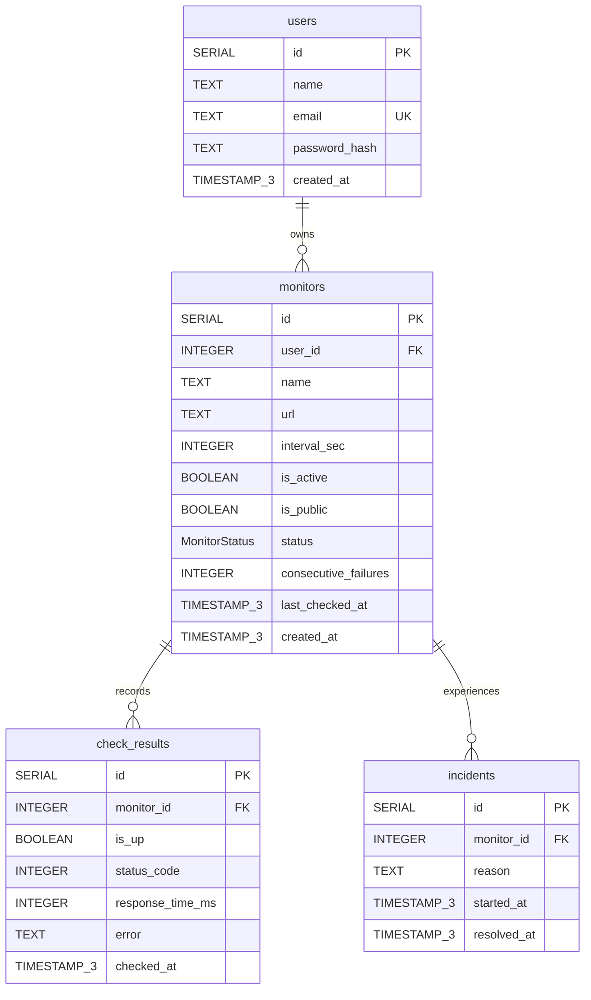

# Kreg Lite — CP2 Entity–Relationship Diagram

The diagram follows `prisma/migrations/20261113181735_init/migration.sql` and the additional constraints in `dbms/03_schema.sql`.

**Legend:** PK = primary key; FK = foreign key; UK = unique key; `TIMESTAMP_3` = PostgreSQL `TIMESTAMP(3)`. The `MonitorStatus` enum contains `UP`, `DOWN`, and `UNKNOWN`. All relationship foreign keys use `ON DELETE CASCADE ON UPDATE CASCADE`. Fields without a key marker are ordinary attributes; nullability and defaults follow `03_schema.sql`.

**Composite candidate keys:** `check_results (monitor_id, checked_at)` and `incidents (monitor_id, started_at)` are unique pairs. They are not separate single-column UNIQUE constraints. A partial unique index additionally enforces at most one incident per monitor with `resolved_at IS NULL`.

**Cardinalities:** users (1) → (0..N) monitors; monitors (1) → (0..N) check_results; monitors (1) → (0..N) incidents. Every child record belongs to exactly one parent.
